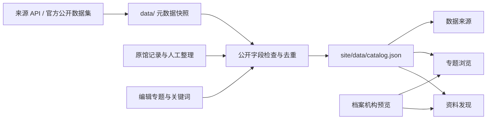

# WWII Pacific War — 资料发现与专题浏览

**WWII Pacific War / 二战太平洋战场**面向太平洋战争研究，重点覆盖中国、缅甸及中缅印战区。应用以两个入口连接同一份档案目录：**资料发现**用于主动搜索，**专题浏览**用于阅读已整理的主题资料。每条记录保留收藏机构、原馆链接和权利说明。

当前为已上线、也可本地运行的双语研究 Demo：**55 条去重记录、10 个来源机构、10 个研究专题**。网页搜索已导入的快照，不实时查询外馆。网站通过 Firebase Hosting 公开托管：[打开网站](https://project-864074c6-a2ba-4b47-a1f.web.app/)。用户账户、实时搜索后端、LLM 对话和研究成果发布尚未实现；馆藏管理不在范围内。

## 在线访问

- [资料发现](https://project-864074c6-a2ba-4b47-a1f.web.app/?lang=zh-CN)
- [专题浏览](https://project-864074c6-a2ba-4b47-a1f.web.app/topics.html?lang=zh-CN)
- [数据来源](https://project-864074c6-a2ba-4b47-a1f.web.app/sources.html?lang=zh-CN)

三个页面共享当前目录，支持 English／中文。访问公开网站无需本地 Python 或 API 凭据。

## 本地运行

需要 **Python 3.9+、现代浏览器**。预览无需安装 Python／npm 依赖或提供 API key。

```sh
cd /Users/jingxugao/Documents/sf-pacific-war-harness/step1-discovery
python3 tools/serve.py
```

| 导航顺序 | 页面 | 本地地址 |
| --- | --- | --- |
| 1 | 资料发现：关键词搜索、筛选、详情 | [首页](http://127.0.0.1:8000/) |
| 2 | 专题浏览：已整理的主题、导读和档案卡片 | [专题浏览](http://127.0.0.1:8000/topics.html) |
| 3 | 数据来源：机构、记录数量与收录方式 | [数据来源](http://127.0.0.1:8000/sources.html) |

首次访问默认 English，右上角可切换 English／中文并记住主动选择；`?lang=en` 或 `?lang=zh-CN` 指定语言。旧的 `/cbi-demo.html` 地址跳转至专题浏览并保留查询参数。目录检索不消耗 API 配额；外部预览与原馆链接需要联网。

启动时自动离线重建统一目录。按 Ctrl+C 停止；端口占用时运行 `python3 tools/serve.py --port 8001`。

## 当前功能

| 功能 | 当前行为 |
| --- | --- |
| 统一目录 | 来源快照、主题候选与人工整理的原馆记录进入同一份索引；按原生编号／规范化原馆 URL 去重，统一执行排除规则 |
| 资料发现 | 搜索原始标题、摘要、机构、档案背景、编辑专题词与导读；按来源、类型、目录年份、访问状态筛选，支持相关性及日期排序 |
| 专题入口 | 首页“Start with a topic”合并专题关键词及常用示例；点击发起新的关键词检索 |
| 专题浏览 | 按主题阅读照片、地图、文献、实物和研究入口；优先显示带档案预览的记录，每批 12 条；导读、关键词、原馆链接和详情均可访问 |
| 浏览与搜索衔接 | 专题中的“在资料发现中检索这个专题”打开同一组记录；关键词链接发起新的检索；导航返回保留原有搜索条件 |
| 双语检索 | 固定词表及专题关键词支持中英文、部分繁体与日文名称；同组别名按 OR、不同词组按 AND；支持引号词组并显示扩展词 |
| 双语界面 | 菜单、控件、专题导读、状态与错误提示支持中英文；档案原始标题、描述与权利原文保留 |
| 临时演示提示 | 顶部可关闭的横幅显示实际样本数、来源数与更新时间；同一浏览器标签页会话中跨页面保持关闭；永久页面布局不显示统计条 |
| 资料详情 | 展示出处、档号、原始元数据、编辑导读、主题标签、权利及访问条件；原始获取时间与人工核查时间分别记录 |
| URL 状态 | 搜索条件、语言及专题浏览选择可恢复；可链接到单条记录详情；支持刷新及浏览器前进／后退 |
| 响应式卡片 | 桌面三列、平板两列、手机单列；突出预览、标题、摘要，图片不可用时显示占位 |

专题标签及导读是编辑整理，不能当作原馆元数据或身份核实结论。关键词命中不等于史料相关性已确认，目录可查也不等于原件全文开放。预览图片只从允许的档案机构域名加载，媒体使用权需逐条核对。

## 数据覆盖

当前快照如下；刷新后数量可能变化。专题之间允许重叠，专题计数不可相加为唯一记录总数。

| 来源机构 | 记录数 | 收录方式 |
| --- | ---: | --- |
| 美国国会图书馆（Library of Congress，LoC） | 22 | API 元数据、人工整理的原馆记录 |
| 欧洲数字文化遗产平台（Europeana） | 3 | Search API 元数据 |
| 美国国家档案馆（National Archives and Records Administration，NARA） | 9 | RG 493 官方公开数据集、官方图片目录 |
| 互联网档案馆（Internet Archive） | 2 | 人工整理的数字化读物记录 |
| 史密森尼学会（Smithsonian Institution） | 3 | 人工整理的馆藏实物与研究入口 |
| 美国中央情报局（Central Intelligence Agency，CIA） | 1 | 官方历史资料入口 |
| 英国帝国战争博物馆（Imperial War Museums，IWM） | 2 | 人工整理的影片目录 |
| 美国陆军联合兵种研究图书馆（Combined Arms Research Library，CARL） | 1 | 人工整理的文献记录 |
| 莱斯大学（Rice University） | 1 | 人工整理的数字馆藏记录 |
| 台湾国家发展委员会档案管理局（National Archives Administration, Taiwan） | 11 | 官方开放案卷目录 CSV；按主题选入，保留档号与全宗 |
| **合计** | **55** | 有限研究样本，不代表完整馆藏 |

台湾目录保留繁体原题名、全宗、档号及目录资料产制日期。CSV 没有摘要、逐件详情 URL 或历史年代；不会将资料产制日期、档号中的年份当作档案日期。详情提供 A+ 查档入口，部分记录附原馆精选文件链接。当前导入来自有界 CSV 前缀，不代表完整目录。

专题包括飞虎队与航空、驼峰航线、滇缅公路、雷多公路与盟军运输、缅甸战役与部队、个人经历与回忆、战时报刊与生活指南、文物与识别标志、地图与军事档案、民众卫生与日常生活。

公开页面仅呈现档案记录、编辑主题与原馆出处。研究过程中的参考清单、对照依据、访问日志及待处理队列保存在 `data/` 和 `docs/`，不随网站发布。人工整理入口不代表该机构已接通搜索 API。

## 系统设计与目录

前端为原生 HTML／CSS／JavaScript ES modules；Python 标准库负责获取、规范化、接入检查和离线构建。浏览器读取一份 `site/data/catalog.json` 完成检索与专题浏览，无数据库或前端框架依赖。本地 `ThreadingHTTPServer` 仅服务 `site/`。



```text
step1-discovery/
  README.md
  .env.example                  空白凭据模板
  .firebaserc / firebase.json    Firebase 项目与静态托管配置
  site/
    index.html / app.js          资料发现
    topics.html / topics.js      专题浏览
    sources.html / sources.js    数据来源
    cbi-demo.html                兼容旧地址的跳转页
    data/catalog.json            三个页面共享的公开目录
    *.mjs / *.css               检索、语言、页面状态与样式
  tools/
    serve.py                    本地启动与离线构建
    build_site_data.py          统一目录、去重、排除与公开字段检查
    fetch_*_metadata.py         来源元数据获取
    fetch_cbi_archives.py       主题候选获取
    build_cbi_demo.py           内部研究对照报告，不写入 site/
    check_archives.py           统一接入检查
    access_*.py                 逐来源检查
  data/
    *-discovery*.json           来源快照
    topics.json                双语专题、成员与编辑导读
    review-notes.json           排除规则
    cbi/                       主题候选与内部研究依据
  tests/                       Python 与 JavaScript 离线测试
  docs/                        使用、接入与部署文档
```

界面沿用纸色 `#f4f2ed`、海军蓝 `#21374d`、青绿 `#2b6f78` 和黄铜色 `#a8792e`。没有引入新的前端 package。临时演示横幅由 `site/demo-banner.mjs` 的 `DEMO_BANNER_ENABLED` 控制；设为 `false` 可整体关闭。默认语言只受 URL 参数和用户主动保存的选择覆盖，不使用浏览器语言自动切换。

## 数据更新与凭据

以下获取命令会联网；按需要选择来源。预览已有数据只需启动服务。

```sh
# LoC 的标准样本
python3 tools/fetch_public_metadata.py --source all
# 台湾档案局公开目录：有界下载后本地匹配；无需 key，样本需审阅
python3 tools/fetch_taiwan_metadata.py --live --query '驻印军|滇缅|远征军|缅甸' --rows 20 --output data/taiwan-discovery-candidates.json
# NARA 固定公开目录分片
python3 tools/fetch_nara_metadata.py
# Europeana，凭据仅保存在本地
python3 tools/fetch_europeana_metadata.py --env-file .env.archives --query '"Burma Road"' --rows 3 --output data/europeana-discovery-candidates.json
# 主题候选：默认仅查看计划；加 --live 才联网
python3 tools/fetch_cbi_archives.py
python3 tools/fetch_cbi_archives.py --live --env-file .env.archives
# 重建三个页面共享的目录，不联网
python3 tools/build_site_data.py
```

台湾命令只生成候选文件，不替换已发布的 11 条核查记录。审阅候选并将选定记录及其获取范围写入 `data/taiwan-discovery.json` 后，再运行构建器。

维护主题、成员记录与编辑导读时修改 `data/topics.json`；其中 `reading_links` 为台湾记录补充已核实的原馆精选文件页面。新增候选仍需审阅出处、主题与权利；构建器不会自动确认其历史相关性。构建日期不会替换来源获取日期或人工核查日期。重复来源快照会保留既有来源记录，人工整理记录可补充带标签的核查时间、访问说明和档号。

需要 API 凭据时：

```sh
cp -n .env.example .env.archives
chmod 600 .env.archives
# 填写本机文件后检查；默认不联网
python3 tools/check_archives.py --env-file .env.archives --format table
# 在线小请求：API 使用原词；台湾 CSV 支持有限别名扩展
python3 tools/check_archives.py --live --env-file .env.archives --query '飞虎队' --rows 3 --format table
# NARA 固定数据集不支持关键词查询
python3 tools/access_nara.py --live --rows 3
```

LoC、NARA 公开数据集和台湾档案局 CSV 不需要 key；Europeana 使用 `EUROPEANA_API_KEY`。NARA Catalog API、美国数字公共图书馆（DPLA）需要各自凭据；英国国家档案馆（TNA）需先解决访问授权。台湾档案局提供无需 key 的 CSV 接入，支持有限简繁与英文别名；这是下载后的本地匹配，不是 A+ 实时搜索 API。日本亚洲历史资料中心（JACAR）和 IWM 检查器仍只提供网页入口。完整访问状态、测试命令与生产接入步骤见文档索引。

填好的 `.env.*` 文件由 Git 忽略，不进入 `site/` 或公开 JSON。接入检查只输出状态，不更新网页数据；在线检查有不可用来源时可返回退出码 2。

## 页面与 URL 参数

本地服务绑定 `127.0.0.1:8000`，支持静态 GET／HEAD，拒绝目录列表、隐藏路径、路径穿越与符号链接。公开 JSON 为 `/data/catalog.json`；没有 `/api/search`、上传、登录或刷新接口。

| 参数 | 页面与含义 |
| --- | --- |
| `lang` | 全站：`en` / `zh-CN` |
| `q` | 资料发现：最多 240 字符的关键词 |
| `topic` | 资料发现：专题 ID，与关键词和来源筛选取交集 |
| `source`、`type` | 资料发现：可重复的来源／类型条件；类型包括 `OBJECT` 实物 |
| `from`、`to`、`unknown` | 资料发现：1000–2100 目录年份；`unknown=0` 排除日期不详 |
| `access`、`sort` | 资料发现：`online` / `unverified`；`relevance` / `newest` / `oldest` |
| `record` | 资料发现：打开指定记录详情 |
| `browse` | 专题浏览：当前专题 ID；不使用搜索页的关键词隐藏浏览内容 |

例子：[搜索飞虎队](http://127.0.0.1:8000/?lang=zh-CN&q=飞虎队)、[飞虎队专题](http://127.0.0.1:8000/topics.html?lang=zh-CN&browse=flying-tigers)。本机链接只能在运行该服务的电脑使用。

## 测试与部署

```sh
python3 -B -m unittest discover -s tests -p 'test_*.py' -v
node --test tests/*.test.mjs
```

测试覆盖规范化、跨输入去重与排除、公开字段边界、凭据处理、HTTP 隔离、多语言搜索、专题成员及导航状态。测试不连接外馆；HTTP 测试需要短暂绑定本机端口。Node.js 仅用于开发测试；网站运行无需 Node.js。

Firebase Hosting 仅发布 `site/`；发布前自动运行统一目录构建器。项目为 **FTCBI-Digital-Web**（`project-864074c6-a2ba-4b47-a1f`），公开站点为 [https://project-864074c6-a2ba-4b47-a1f.web.app](https://project-864074c6-a2ba-4b47-a1f.web.app)，已通过线上页面、检索、语言切换、静态文件一致性与私有路径隔离验证。模拟器端口为 `5105`，生产监控尚未配置。完整步骤见 [Firebase Hosting 部署](docs/firebase-hosting.md)。

## 下一步

1. 维护公开试点的数据更新、发布与回滚流程，补充运行监控。
2. 审阅更多资料，补充结构化日期、档号、作者、版本与媒体权利，扩展双语专题及检索评估样本。
3. 按来源取得 API 凭据和使用许可，建设托管搜索后端，处理分页、限流、超时、缓存和部分失败。
4. 在有明确引用和使用权限的材料上增加 LLM 问答、专题编辑与研究成果发布。

## 文档索引

- [专题浏览与演示操作](docs/topics.md)
- [Firebase Hosting 部署](docs/firebase-hosting.md)
- [平台中英文名称](docs/archive-platform-names.md)
- [接入方式与凭据](docs/archive-access.md)
- [逐平台访问验证](docs/archive-access-validation.md)
- [关键词命令](docs/archive-search-commands.md)
- [生产整合计划](docs/archive-access-production-plan.md)
- [欧洲数字文化遗产平台（Europeana）](docs/europeana.md)
- [台湾档案管理局（archives.gov.tw）](docs/taiwan-archives.md)
