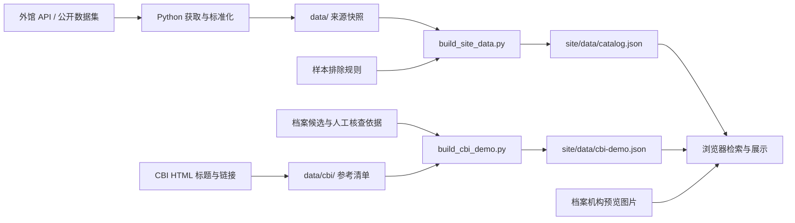

# WWII Pacific War — 统一发现与档案研究 Demo

**WWII Pacific War / 二战太平洋战场**是一个面向太平洋战争研究的资料发现应用，重点覆盖中国、缅甸及中缅印战区。研究者可以跨机构搜索目录、查看资料预览和出处，并回到原馆阅读；CBI 演示页提供参考线索与档案记录的对照核查。

当前状态为**可本地运行的双语研究 Demo**：静态前端、Python 数据工具、人工刷新元数据。网页搜索本地快照，不实时查询外馆。公开部署、用户账户、实时搜索后端、LLM 对话和研究成果发布尚未实现；馆藏管理不在本应用范围内。

## 快速开始

运行要求：**Python 3.9+、现代浏览器**。预览无需安装 Python／npm 依赖或配置 API key。以下所有命令均在本应用目录执行。

```sh
python3 tools/serve.py
```

| 页面 | 本地地址 | 用途 |
| --- | --- | --- |
| 资料发现 | [http://127.0.0.1:8000/](http://127.0.0.1:8000/) | 跨来源搜索、筛选、资料详情 |
| 数据来源 | [http://127.0.0.1:8000/sources.html](http://127.0.0.1:8000/sources.html) | 检索来源、样本数量与覆盖范围 |
| CBI 演示 | [http://127.0.0.1:8000/cbi-demo.html](http://127.0.0.1:8000/cbi-demo.html) | 档案对照、研究候选、参考清单与接入证据 |

页面右上角可切换 English／中文；地址加 `?lang=en` 或 `?lang=zh-CN` 可指定语言。预览图片和原馆链接需要联网，目录搜索本身不消耗 API 配额。

按 `Ctrl+C` 停止服务。更换端口：

```sh
python3 tools/serve.py --port 8001
```

启动时自动重建首页目录 `site/data/catalog.json`；CBI 页面读取随项目提供的 `site/data/cbi-demo.json`。修改 CBI 数据后，需单独运行 `python3 tools/build_cbi_demo.py`。页面通过 HTTP 读取 JSON，应使用上述服务访问。

## 当前功能

| 功能 | 行为 |
| --- | --- |
| 双语界面 | 菜单、筛选、帮助、详情标签与错误提示支持中英文；档案标题、描述及权利原文保留，不自动翻译 |
| 跨来源检索 | 搜索标题、描述、主题、机构及档案背景；每条结果保留来源与记录编号 |
| 多语言主题词 | “缅甸”“滇缅公路”“英帕尔”“中国远征军”使用固定中英日别名；界面显示扩展词。同组别名按 OR、不同词组按 AND 匹配，支持引号词组 |
| 筛选与排序 | 按来源、资料类型、目录年份、访问状态筛选；日期不详可保留或排除；支持相关性与日期排序 |
| 资料卡片与详情 | 桌面三列、平板两列、手机单列；卡片突出预览、标题与摘要，检索结果每批 12 条。详情展示完整元数据、权利说明及原馆链接；无图或图片失败时显示占位 |
| 可恢复的检索状态 | 资料发现页将关键词、筛选、排序与语言写入 URL；刷新、前进／后退及与来源页往返可恢复条件 |
| CBI 参考核查 | 展示人工对照及其依据、档号、权利说明和下一步；档案候选可按关键词与来源筛选，参考清单可按文字、类型及核对状态筛选 |
| 接入证据 | 显示来源访问状态与带时间戳的查询结果，区分 API、公开数据集、网页查找和缺少凭据等情况 |
| 异常处理 | 空结果、日期输入校验、数据加载失败与重试、图片加载失败占位 |

主题词扩展属于固定词表匹配，不是通用语义搜索。排序表示字段匹配程度，不表示历史材料的重要性。CBI 页的候选与清单筛选在页面内生效，目前只有界面语言写入 URL。

## 系统设计

| 层 | 实现与职责 |
| --- | --- |
| 前端 | 原生 HTML、CSS、JavaScript ES modules；浏览器完成检索、筛选、分页与语言切换，无前端构建依赖 |
| 数据工具 | Python 标准库；从外馆获取元数据、规范化字段、执行接入检查、生成参考清单及公开 JSON |
| 数据存储 | `data/` 保存来源快照与核对依据；`site/data/` 保存供浏览器读取的公开快照 |
| 本地服务 | Python `ThreadingHTTPServer`；仅提供 `site/` 静态文件，无数据库或后台搜索服务 |
| 验证 | Python `unittest` 与 Node.js 内置测试运行器；自动测试使用离线数据和合成凭据 |



公开记录保留来源 ID、原馆链接、原文、机构、类型、语种、日期、获取时间、访问状态及权利说明。美国国家档案馆（NARA）记录还保留档案层级和祖先标题。来源获取时间、目录日期与数据文件更新时间分别保存；构建快照不会把它们改成构建日期。

界面使用纸色背景 `#f4f2ed`、浅色卡片 `#fffdf8`、海军蓝 `#21374d`、青绿 `#2b6f78` 和黄铜色 `#a8792e`，配合系统字体与本机衬线字体。

### 目录结构

```text
step1/
  README.md
  .env.example                  可选凭据模板
  tools/
    serve.py                    本地静态服务
    build_site_data.py          生成资料发现页目录
    build_cbi_demo.py           生成 CBI 演示快照
    fetch_*_metadata.py         各来源元数据获取与标准化
    fetch_cbi_archives.py       CBI 主题候选获取
    inventory_cbi.py            CBI HTML 参考清单
    check_archives.py           统一接入检查
    access_*.py                 逐来源接入检查
  data/
    *-discovery*.json           各来源元数据快照
    review-notes.json           样本排除规则与依据
    cbi/                        参考清单、档案候选、对照及访问证据
  site/
    index.html                  资料发现
    sources.html                数据来源
    cbi-demo.html               CBI 演示
    *.js / *.mjs / *.css        交互、检索、语言与样式
    data/catalog.json           公开检索目录
    data/cbi-demo.json          公开 CBI 演示数据
  tests/                        Python 与 JavaScript 测试
  docs/                         操作说明、接入规范与研究证据
```

## 数据覆盖与核查状态

以下为随项目提供的数据快照状态（截至 **2026-10-12 UTC**）；刷新后数量可能变化。两个页面的数据集用途不同、存在重叠，不能相加为唯一记录总数。

| 来源 | 资料发现页 | CBI 档案候选 | 范围 |
| --- | ---: | ---: | --- |
| 美国国会图书馆（Library of Congress，LoC） | 16 | 19 | 以滇缅公路、雷多公路等主题取得的目录元数据 |
| 日本国立国会图书馆（National Diet Library，NDL） | 9 | 14 | NDL Search 中 `iss-ndl-opac` 书目，包含战后出版物 |
| 欧洲数字文化遗产平台（Europeana） | 1 | 3 | Search API 主题候选，应用人工排除规则 |
| 美国国家档案馆（National Archives and Records Administration，NARA） | 5 | 5 | RG 493 中缅印战区官方公开目录数据集中的一个分片 |
| **合计** | **31** | **41** | 均为有限样本，不代表完整馆藏 |

CBI 演示另有 **20 条人工对照，涉及 10 个档案／馆藏机构**：4 条识别同一作品或报刊期次，15 条为主题相关材料，1 条待确认。没有已认定的同一照片／同一实物匹配。完整机构名称、记录链接与判断依据见 [人工对照表](docs/cbi-archival-matches.md)。

### CBI 参考边界

**CBI Theater 只作为题材、标题、书目与链接的参考入口。不下载、缓存或展示其图片、PDF、音频或视频，也不保留文章正文。所有展示的预览来自档案机构。** 图片 URL 在参考清单中仅作为文字指针；构建器和前端分别校验预览来源。

当前清单包含：

- 首页 351 个内部地址均已尝试读取，其中 349 成功。
- 全部层级累计尝试 1,200 个页面地址：1,192 成功、8 个 HTTP 404；已发现页面共 2,693 个，尚有 1,493 个未访问。
- 12,335 个图片 URL 引用和 93 个 PDF URL 引用，均未请求对应媒体。

清单受请求数量、链接可见性及深度限制，**全站逐件核查尚未完成**。图片引用可能是装饰图、扫描件或重复使用的文件，不等于独立历史照片／文物数量。页面级作品对应不会自动确认该页每张图片；标题相似只能形成待核实线索。详细范围见 [覆盖记录](data/cbi/coverage.md)。

## 接入方式与凭据

接入检查覆盖 **9 个平台、10 种方式**。数据获取、连通性检查和人工网页查找分别记录；有可访问的网页不代表已接通搜索 API。

| 平台／方式 | 凭据或前提 | 当前能力 |
| --- | --- | --- |
| 美国国会图书馆（LoC） | 无需 key | API 元数据获取、标准化与检查 |
| 日本国立国会图书馆（NDL） | 无需 key | OpenSearch 元数据获取、标准化与检查 |
| 欧洲数字文化遗产平台（Europeana） | `EUROPEANA_API_KEY` | Search API 元数据获取、标准化与检查 |
| 美国国家档案馆（NARA）公开数据集 | 无需 key 或 AWS 账户 | 固定分片读取与检查；不支持关键词查询 |
| 美国国家档案馆（NARA）Catalog API | `NARA_API_KEY` | 检查适配器已实现；当前访问报告为缺少凭据，待真实验证 |
| 美国数字公共图书馆（Digital Public Library of America，DPLA） | `DPLA_API_KEY` | 检查适配器已实现；当前访问报告为缺少凭据，待真实验证 |
| 英国国家档案馆（The National Archives，TNA） | 预先取得 IP 访问授权 | 检查适配器已实现；当前待授权，公开网页线索单独记录 |
| 日本亚洲历史资料中心（Japan Center for Asian Historical Records，JACAR） | 正式数据接入方式待确认 | 官方网页与具体记录线索；检查器返回 `manual_only` |
| 英国帝国战争博物馆（Imperial War Museums，IWM） | 正式数据接入方式待确认 | 官方馆藏网页线索；检查器返回 `manual_only` |
| 台湾档案管理局（National Archives Administration, Taiwan） | 正式数据接入方式待确认 | 官方网页／开放数据入口；检查器返回 `manual_only`，未实现 CSV 检索 |

需要凭据时，复制模板并在本机填写所需字段：

```sh
cp -n .env.example .env.archives
chmod 600 .env.archives
```

凭据可通过进程环境变量或命令的 `--env-file` 提供。填写后的 `.env.*` 文件由 Git 忽略，不放入 `site/`、公开 JSON 或 URL。预览现有数据不读取凭据。

检查配置或在线测试一个关键词：

```sh
# 仅检查配置，不联网
python3 tools/check_archives.py --env-file .env.archives --format table

# 对满足访问条件的来源执行小请求
python3 tools/check_archives.py --live --env-file .env.archives --query '飞虎队' --rows 3 --format table

# 无关键词的 NARA 固定公开数据集检查
python3 tools/access_nara.py --live --rows 3
```

关键词原样发送，不自动翻译；可将 `飞虎队` 换成 `Flying Tigers` 对照。统一关键词检查会对 NARA 固定数据集报告 `query_not_supported`。缺 key、待授权与仅网页入口分别列出；检查只输出状态和计数，不更新网页样本。在线检查存在不可用来源时可返回退出码 `2`，应结合逐来源结果判断。

逐平台命令、退出码与前提见 [接入说明](docs/archive-access.md) 和 [关键词命令](docs/archive-search-commands.md)。

## 数据更新

### 资料发现页

以下获取命令会联网；按需要选择来源执行。候选应核对相关性、日期和权利条件，并在 `data/review-notes.json` 中维护排除规则。

```sh
# 美国国会图书馆（LoC）与日本国立国会图书馆（NDL）
python3 tools/fetch_public_metadata.py --source all

# 美国国家档案馆（NARA）：一个固定公开目录分片
python3 tools/fetch_nara_metadata.py

# 欧洲数字文化遗产平台（Europeana）
python3 tools/fetch_europeana_metadata.py --env-file .env.archives --query '"Burma Road"' --rows 3 --output data/europeana-discovery-candidates.json

# 从本地快照构建公开目录，不联网
python3 tools/build_site_data.py
```

`--source all` 仅指 LoC 与 NDL；自定义查询需指定 `--source loc` 或 `--source ndl`，再传 `--query`。这些获取工具不自动翻页；成功获取会替换对应来源快照，失败保留可用文件。NARA 的 `--limit` 仅限制单个分片的保留条数，不是搜索或翻页参数。刷新结果需重新审阅，不会自动成为已核实资料。

### CBI 演示页

```sh
# 查看获取计划，不联网、不写数据
python3 tools/fetch_cbi_archives.py

# 获取主题候选，然后构建公开快照
python3 tools/fetch_cbi_archives.py --live --env-file .env.archives
python3 tools/build_cbi_demo.py
```

候选获取工具查询 LoC、NDL 与 Europeana，并使用本地 NARA 数据集记录；每个平台三个固定主题，每次默认三条，限制请求间隔和结果量。遇到限流停止该平台；部分失败时保存可用部分并返回非零退出码。未重新获取的记录保留实际获取日期。

继续发现 CBI **HTML 元数据**引用：

```sh
python3 tools/inventory_cbi.py --resume --max-pages 2000 --max-depth 8 --delay 1
python3 tools/build_cbi_demo.py
```

`--max-pages` 是累计上限。爬取器遵守 robots、限定同站 HTML、检查重定向，并保存未访问队列；不会获取 CBI 媒体或执行页面脚本。人工对照在 `data/cbi/verified-matches.json` 中维护；自动标题匹配不会提升核对状态。操作细节见 [CBI 演示指南](docs/cbi-demo.md)。

## HTTP 入口与页面状态

本地服务固定绑定 **`127.0.0.1`**，默认端口 **8000**，支持静态 `GET`／`HEAD`；仅本机可访问，无 `--host` 选项。HTTP 根目录为 `site/`。

| 路径 | 内容 |
| --- | --- |
| `/`、`/index.html` | 资料发现页面 |
| `/sources.html` | 数据来源页面 |
| `/cbi-demo.html` | CBI 参考核查页面 |
| `/data/catalog.json` | 资料发现页的公开目录快照 |
| `/data/cbi-demo.json` | CBI 演示的公开数据快照 |

静态资源同样位于 `site/`。目录列表、隐藏路径、路径穿越和符号链接访问被拒绝；根目录的 `data/`、凭据、工具与文档不经该服务开放。这些 JSON 路径是静态文件，当前没有 `/api/search`、上传、登录、刷新或发布接口。

资料发现页的 URL 参数：

| 参数 | 含义 |
| --- | --- |
| `lang`、`q` | `en`／`zh-CN`；搜索词最多 240 字符 |
| `source` | `LoC`、`NDL`、`Europeana`、`NARA`；可重复 |
| `type` | `IMAGE`、`TEXT`、`MAP`、`SOUND`、`VIDEO`、`MIXED`；可重复 |
| `from`、`to`、`unknown` | 目录年份范围 1000–2100；`unknown=0` 排除日期不详 |
| `access` | `online`／`unverified`；省略时全部 |
| `sort` | `relevance`／`newest`／`oldest` |

例如：`http://127.0.0.1:8000/?lang=en&q=Burma&source=LoC&source=NARA&sort=oldest`。参数只控制本地浏览器检索；本机地址不是可供其他电脑访问的公共分享链接。

## 测试与部署状态

```sh
python3 -B -m unittest discover -s tests -p 'test_*.py' -v
node --test tests/*.test.mjs
```

测试套件包含 **181 项 Python 测试、20 项 JavaScript 测试**，覆盖标准化、公开字段边界、凭据处理、HTTP 文件隔离、检索与语言切换、爬取范围、预览来源及匹配状态。测试不连接外馆或消耗 API 配额；HTTP 隔离测试需要短暂绑定本机端口。Node.js 仅用于开发测试，建议使用 Node.js 22；网页运行无需 Node.js。

当前交付为本地应用，未配置公开部署和生产监控。`site/` 是静态托管产物；部署前分别运行两个构建器，并检查元数据与预览的公开展示条件。真实访问状态见 [接入验证记录](docs/archive-access-validation.md) 及 CBI 演示中的时间戳报告；端点可用性可能随时间变化。

## 限制与下一步

样本覆盖有限，固定别名不保证任意跨语言查询命中。数据按来源 ID 去重，尚无跨馆实体合并或自动版本识别。目录可访问不等于原件全文开放；有预览不等于拥有转载许可。目录日期也不能一律解释为战役发生时间。

| 优先级 | 工作 | 完成标准 |
| --- | --- | --- |
| 1：资料与核查 | 扩大经过审阅的主题样本；继续处理参考清单；补档号、作者、日期、版本与媒体权利；建立检索评估用例 | 记录出处和身份判断可复核，能解释检索命中与覆盖缺口 |
| 2：公开试点 | 将 `site/` 发布到托管静态服务，配置 HTTPS、构建验证、更新与回滚流程 | 无需本地 Python 即可访问；发布产物不含凭据，失败更新可恢复 |
| 3：实时检索 | 按来源取得凭据与使用许可，建设托管后端，处理缓存、分页、限流、超时和部分失败 | 已启用来源可统一查询，来源故障和结果范围明确可见 |
| 4：研究扩展 | 基于可引用、可使用的材料增加 LLM 问答、专题整理与研究成果发布 | 回答和发布内容有可追溯引文、版本及权利依据 |

生产接入按来源分别设计，详见 [访问状态与生产整合计划](docs/archive-access-production-plan.md)。

## 文档索引

- [CBI 演示指南与操作命令](docs/cbi-demo.md)
- [人工档案对照与证据](docs/cbi-archival-matches.md)
- [补充平台网页核查](docs/cbi-platform-web-checks.md)
- [平台中英文名称](docs/archive-platform-names.md)
- [逐平台接入、凭据与测试](docs/archive-access.md)
- [检索词与完整命令](docs/archive-search-commands.md)
- [欧洲数字文化遗产平台（Europeana）接入说明](docs/europeana.md)
- [台湾档案管理局（archives.gov.tw）接入说明](docs/taiwan-archives.md)
