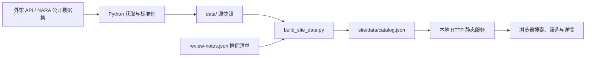

# Step 1 统一发现 Demo

文档与代码核对日期：**2026-10-11**。本文介绍当前功能、端口与接口、运行方式和下一步计划；标注“规划”的内容尚未实现。

Step 1 的页面、工具、数据、测试、说明和本地配置集中在本目录。功能范围是跨来源检索、筛选、详情和跳转原馆；不包含馆藏管理、LLM、研究工作台或出版。

前端和四个来源的元数据获取工具已实现。当前网页包含 **31 条真实目录样本**：LoC 16 条、NDL 9 条、Europeana 1 条、NARA 5 条。NARA 使用官方公开数据集，无需 key 或 AWS 账户；另外三个来源通过 API 取得样本。Europeana 原始 3 条候选中有 2 条因同名误命中或相关性未确认而暂不展示。网页检索本地快照，不实时请求外馆，也不代表完整馆藏。

## 项目定位与当前功能

本项目为太平洋战争研究提供统一的资料发现入口，当前重点是中国、缅甸及中缅印战区。研究者输入一次关键词，即可在同一列表查看不同机构的目录记录，再回到原馆继续阅读。

当前阶段是**可在本地运行的研究 Demo**。没有公网部署、登录系统、数据库或后台搜索服务。数据由命令行工具人工刷新，浏览器读取生成的目录快照并完成检索；启动网页不会自动向外馆取数。

| 已实现功能 | 当前行为 |
| --- | --- |
| 中英界面 | 顶部 English／中文切换；菜单、筛选、详情标签、帮助及错误提示随语言变化，档案标题、描述和权利原文保留 |
| 统一检索 | 同时搜索各来源的标题、描述、主题词、机构及相关目录字段；结果保留来源标识 |
| 中英日主题扩展 | 预设“缅甸”“滇缅公路”“英帕尔”“中国远征军”4 组别名，显示实际扩展词 |
| 关键词组合 | 同一主题的别名按 OR 匹配，不同词组按 AND 匹配；支持引号词组 |
| 来源与类型筛选 | 多选来源和资料类型；同一组多选为 OR，不同筛选组之间为 AND |
| 目录日期筛选 | 按来源日期区间筛选，可包含或排除日期不详记录；检查起止年顺序 |
| 访问状态筛选 | 区分“有在线资源”和“访问条件待确认” |
| 排序与加载 | 按相关性、日期由新到旧／由旧到新排序；每批显示 10 条，可加载更多 |
| 资料详情 | 查看原始目录标题与描述、机构、语种、日期、记录编号、权利说明及原馆链接 |
| NARA 档案背景 | 保留档案组、系列／案卷层级、真实祖先标题及公开数据出处；祖先标题参与检索 |
| 查询链接 | 将搜索、筛选和排序写入 URL；刷新或浏览器前进／后退可以恢复这些条件 |
| 手机及异常状态 | 窄屏布局、折叠筛选、空结果提示、数据加载失败与重试 |

跨语言能力来自固定词表，不是自动翻译或通用语义搜索。相关性排序按字段命中计算，不等于对史料价值或历史事实作出判断。

### 当前来源范围

“接入”表示已取得真实数据并纳入检索，单纯的外部网站链接不算数据接入。

| 来源 | 当前范围 | 凭据 | 展示数量 |
| --- | --- | --- | ---: |
| LoC | `/photos/` API 的 Burma Road 主题样本，不是全 LoC 目录 | 无需 key | 16 |
| NDL Search | 限定 `iss-ndl-opac` 的日文书目，含战后出版物 | 无需 key | 9 |
| Europeana | Search API 的 `"Burma Road"` 候选，已排除 2 条误命中或相关性未确认记录 | `EUROPEANA_API_KEY` | 1 |
| NARA | 官方公开数据集的一个 RG 493 中缅印战区目录分片 | 无需 key 或 AWS 账户 | 5 |

现有样本获取于 **2026-10-10 UTC**。索引可以重新构建，但新的构建时间不表示重新获取过外馆数据。NARA 另保留数据文件更新时间，该时间也不是档案事件日期。

### 可复现的跨平台检索

以下结果基于当前 31 条样本，未加来源、日期等额外筛选；更新样本后数量可能变化。

| 搜索词 | LoC | NDL | Europeana | NARA | 合计 |
| --- | ---: | ---: | ---: | ---: | ---: |
| 缅甸 | 16 | 7 | 1 | 5 | 29 |
| 滇缅公路 | 13 | 1 | 1 | 0 | 15 |
| 英帕尔 | 0 | 1 | 0 | 0 | 1 |

NARA 命中可能来自所属档案组标题；详情会显示这层背景，并不表示每个下属文件都直接讨论该关键词。

## 本地打开网页

只需 Python 3.9 或以上和现代浏览器，无需安装依赖、Node.js 或填写 API key：

```sh
# 从 memory-next 仓库根目录进入应用
cd step1
python3 tools/serve.py
```

打开 **http://127.0.0.1:8000**。启动工具会先从本地样本生成网页数据，然后只开放 `site/`，不会开放本地凭据和工具目录。停止时在终端按 `Ctrl+C`；如果端口被占用，可运行 `python3 tools/serve.py --port 8001` 并打开对应地址。

语言可在右上角选择 **English／中文**。也可以直接打开 [英文界面](http://127.0.0.1:8000/?lang=en) 或 [中文界面](http://127.0.0.1:8000/?lang=zh-CN)。语言选择依次采用 URL `lang`、本机保存偏好、浏览器支持的语言；都未匹配时使用英文。切换保留当前搜索、筛选、排序和已展开的结果数量；刷新／前进／后退可恢复 URL 中的语言及筛选。档案原文不自动翻译，也不需要翻译 API 或 key。

各平台的中文名称、搜索词与完整测试命令见 [检索词与测试命令](docs/archive-search-commands.md)。

可以按以下顺序演示：

1. 输入“缅甸”或“滇缅公路”，查看中文入口对应的中英日别名扩展。
2. 组合来源、资料类型、目录年份和访问状态筛选；支持保留或排除日期未知的记录。
3. 切换相关性／日期排序、加载更多，打开详情核对原始目录描述、来源、目录日期及许可。
4. 点击“前往原馆”；NDL 包含战后出版的书目，目录可访问不代表全文开放。
5. 刷新页面或复制地址，保留当前搜索和筛选条件。地址仅可在运行相同 demo 的环境恢复；`127.0.0.1` 不是供他人访问的公开网址。

页面支持手机窄屏布局和折叠筛选。演示与搜索不消耗 API 配额；前往原馆需要联网。不要双击 `index.html` 直接打开，因为浏览器需要通过本地 HTTP 服务读取目录 JSON。

## 当前开放端口与接口

### 本地监听

| 项目 | 当前配置 | 说明 |
| --- | --- | --- |
| 默认地址 | `127.0.0.1:8000` | 执行启动命令后监听，仅本机可访问 |
| 更换端口 | `python3 tools/serve.py --port 8001` | 替换默认端口，不是额外同时开放一个端口 |
| 协议 | HTTP | 本地预览未配置 HTTPS |
| 网站根目录 | `step1/site/` | 不开放整个项目目录 |
| 数据库／LLM 服务端口 | 无 | 当前没有这些服务 |

`serve.py` 固定绑定 `127.0.0.1`，没有 `--host` 选项。当前没有局域网或公网入口，也不需要配置路由器端口转发。其他电脑上的 `127.0.0.1` 指向那台电脑本身，不能用来访问这台机器的 Demo。

### 现有 HTTP 路径

静态服务支持 `GET`／`HEAD`：

| 路径 | 内容 |
| --- | --- |
| `/`、`/index.html` | 搜索页面 |
| `/data/catalog.json` | 合并后的公开目录快照 |
| `/app.js`、`/search.mjs`、`/i18n.mjs` | 页面交互、检索逻辑与中英文界面文案 |
| `/styles.css`、`/icon.svg` | 样式和图标 |

**`/data/catalog.json` 是静态文件，不是后端搜索 API。** 当前没有 `/api/search`、`/api/records/:id`、`/health`、数据刷新 API、上传、登录或发布接口。

这里的 `/data/catalog.json` 对应 `site/data/catalog.json`，不是项目根目录的 `data/`。源快照、工具、测试、文档和 `.env*` 凭据文件不通过该服务提供；目录列表、隐藏路径、路径穿越和符号链接访问均被拒绝。

### 页面查询参数

以下参数控制前端状态，不触发外馆请求：

| 参数 | 取值／含义 |
| --- | --- |
| `lang` | `en`／`zh-CN`；只切换界面文案，不改变搜索关键词或档案原文 |
| `q` | 搜索词，最多 240 字符 |
| `source` | `LoC`、`NDL`、`Europeana`、`NARA`；可重复选择多个来源 |
| `type` | `IMAGE`、`TEXT`、`MAP`、`SOUND`、`VIDEO`、`MIXED`；仅使用当前样本实际存在的类型，可重复 |
| `from`、`to` | 四位目录年份，界面校验范围为 1000–2100 |
| `unknown=0` | 排除日期不详记录；省略时保留 |
| `access` | `online` 或 `unverified`；省略时全部 |
| `sort` | `newest`、`oldest`；默认 `relevance` |

例如，在 LoC 与 NARA 中查询 Burma，按日期由旧到新排序：

```text
http://127.0.0.1:8000/?q=Burma&source=LoC&source=NARA&sort=oldest
```

### 外部数据接入端点

下面是获取工具的**出站 HTTPS 连接（通常为远端 443 端口）**，不是本应用对外开放的端口。只在主动刷新数据时调用：

| 来源 | 当前代码配置的地址 | 参数／说明 |
| --- | --- | --- |
| LoC | `https://www.loc.gov/photos/` | `q`、`fo=json`、`c` |
| NDL | `https://ndlsearch.ndl.go.jp/api/opensearch` | `any`、`dpid=iss-ndl-opac`、`cnt` |
| Europeana | `https://api.europeana.eu/record/v2/search.json` | `query`、`rows`、`profile=rich`；key 由获取工具读取 |
| NARA | `https://nara-national-archives-catalog.s3.us-east-2.amazonaws.com/descriptions/record-groups/rg_493/rg_493-1.jsonl` | 固定公开数据分片，没有关键词查询参数 |

点击原馆链接时，浏览器会另行访问对应机构网站。

## 技术结构



Europeana key 只由对应的获取工具读取，浏览器使用已生成的公开目录。统一字段保留来源 ID、原文、机构、类型、语种、原馆 URL、目录日期、访问状态与权利说明；不会把不同含义的日期统一解释为战役年份。

## 目录

```text
step1/
  README.md
  .gitignore
  .env.example                   可选凭据的空白模板
  .env.europeana                  自行配置的本机凭据，已忽略，不随仓库提供
  tools/
    fetch_europeana_metadata.py   Europeana 获取与标准化
    fetch_public_metadata.py      LoC／NDL 免 key 获取与标准化
    fetch_nara_metadata.py        NARA 官方公开数据集小样本
    build_site_data.py            生成可公开的目录 JSON
    serve.py                      构建数据并启动本地网页
  data/
    europeana-discovery-candidates.json
    loc-discovery.json
    ndl-discovery.json
    nara-discovery.json
    review-notes.json             样本排除及其原因
  site/
    index.html
    styles.css
    app.js
    search.mjs
    i18n.mjs
    icon.svg
    data/catalog.json             网页读取的目录快照
  tests/
    test_europeana_metadata.py
    test_site_data.py
    test_nara_metadata.py
    search.test.mjs
    i18n.test.mjs
  docs/
    demo-steps.md                  Demo 范围、步骤和验收
    europeana.md                   接入说明和样本注意事项
```

所有 Step 1 文件均在本目录，不再分散到仓库的共享 scripts、tests 或 collections 目录。此处是独立项目目录，仍由外层仓库统一版本管理；未创建嵌套 Git 仓库。

## 可选：刷新真实来源数据

以下命令均在 `step1/` 内运行。预览已有样本无需执行；刷新才会访问外部 API 或公开数据文件。

LoC 与 NDL 不需要注册或 key，每次刷新每个来源只发起一个小请求，不自动翻页：

```sh
python3 tools/fetch_public_metadata.py --source all
```

`--source all` 只包含 LoC 与 NDL。可用 `--source loc` 或 `--source ndl` 只刷新单个来源；`--rows` 范围为 1–20，自定义 `--query` 必须同时选择单个来源。这会更新该来源的当前样本，不会追加到旧样本中。

同一来源两次运行建议至少间隔 5 秒。失败时保留该来源之前的成功快照，终端会报告错误。新增结果仍是待审阅候选，记录数可能变化。

NARA 使用其官方 AWS 开放数据集中的 **RG 493：中缅印战区美军档案**，每次只读取一个约 300 KB 的目录数据文件，不下载扫描件、音频或全文：

```sh
python3 tools/fetch_nara_metadata.py
```

`--limit` 仅限制这个分片中保留多少条记录，不会下载更多分片，也没有实时 `--query` 搜索能力。

这是公开数据集接入，不是 NARA Catalog 实时 API。无需注册、API key 或 AWS 账户；目录详情保留数据文件地址、文件更新时间和档案层级。系列／案卷记录不等同于单件扫描件，文件更新时间也不表示事件日期。搜索会包含真实祖先档案标题，详情中可核对命中的档案背景。[NARA 数据说明](https://www.archives.gov/developer/national-archives-catalog-dataset)、[AWS 官方数据登记](https://registry.opendata.aws/nara-national-archives-catalog/)。

如以后需要实时查询 NARA Catalog，须向 `Catalog_API@nara.gov` 申请 read-only key。API 条款对结果存储存在限制，因此当前没有调用或缓存该 API。[API 接入说明](https://github.com/usnationalarchives/Catalog-API#how-do-i-get-access-to-the-api)。

Europeana 刷新需要自己的 key。仓库不提供凭据；仅预览样本可以跳过。先在本目录创建本地配置：

```sh
cp .env.example .env.europeana
chmod 600 .env.europeana
```

用本地编辑器在 `.env.europeana` 中填入 `EUROPEANA_API_KEY`，然后运行：

```sh
python3 tools/fetch_europeana_metadata.py \
  --env-file .env.europeana \
  --query '"Burma Road"' \
  --rows 3 \
  --output data/europeana-discovery-candidates.json
```

也可通过进程环境变量 `EUROPEANA_API_KEY` 提供凭据。`.env.europeana` 被 Git 忽略，不随仓库复制到其他电脑。不要将 key 复制到网页、公开 JSON、查询链接或 Git。该命令发起一次真实请求，成功后更新候选样本；仍需人工核对相关性。

刷新后，重新启动 `tools/serve.py` 即可自动重建网页目录。若服务仍在运行，可另开终端执行下面的命令，再刷新浏览器：

```sh
python3 tools/build_site_data.py
```

构建仅复制允许公开的字段，并应用 `data/review-notes.json` 中的排除记录；不读取 `.env.europeana`，也不会调用外部 API。

获取工具有 30 秒连接／读取超时和响应体大小限制，不自动重试或翻页。遇到限流不要连续重复请求；接口失败不能视为“没有相关档案”。

## 各平台独立接入检查

从当前状态到 API 配置后复测、再到生产整合的完整步骤见 [访问状态与生产整合计划](docs/archive-access-production-plan.md)。

现提供 **8 个平台、9 种接入方式**的独立 `access_*.py` 和统一检查器。每个平台的凭据要求、未配置行为、完整命令、申请依据和 unit tests 见 [接入与测试说明](docs/archive-access.md)，当前实测结果见 [验证记录](docs/archive-access-validation.md)。

以下命令从本应用目录运行：

```sh
# 默认不联网；缺少 key、待审批与仅网页入口分别列出
python3 tools/check_archives.py

# 已有 Europeana 本地配置时，明确发起小请求；其余来源按条件跳过
python3 tools/check_archives.py --live --env-file .env.europeana

# 仅运行新增的接入检查 unit tests，不需要真实凭据或网络
python3 -B -m unittest discover -s tests -p 'test_a*.py' -v
```

本次 LoC、NDL、NARA 公开数据集和 Europeana 各一次真实请求均通过；DPLA／NARA 实时 API 缺 key，TNA 待 IP 审批，JACAR／IWM 只返回官方网页入口。这些检查只输出状态和计数，不更新网页样本；网页实际检索来源仍为前述四个。

## 运行测试

```sh
python3 -m unittest discover -s tests -p 'test_*.py' -v
```

Python 测试覆盖获取工具、标准化与网页数据边界，使用合成凭据，不连接外网、不消耗 API 配额。搜索逻辑另有无需 npm 依赖的 Node.js 测试：

```sh
node --test tests/*.test.mjs
```

Node.js 仅用于运行这组开发测试，不是预览网页的条件。如果系统 `node` 无法启动，可使用可运行的 Node.js 运行时的绝对路径替换命令中的 `node`；不要因为 Node.js 故障而阻塞 Python 本地预览。

当前 **141 项 Python 测试 + 17 项前端测试（13 项检索、4 项语言切换基础逻辑）**全部通过，其中新增 93 项接入检查测试。Demo 开发期间另行检查过桌面／手机布局、跨平台检索、筛选、详情、日期校验和加载失败后的恢复。自动化测试不连接外馆；HTTP 隔离测试会短暂绑定本机端口。本次另行执行的四来源真实小请求见 [接入验证记录](docs/archive-access-validation.md)，已有网页样本保持不变。

## 已知限制

- 样本量小，不能代表各平台完整馆藏或完整相关史料；没有自动翻页、定时同步或全量索引。
- 固定主题词表不能保证任意中文人物、地名都命中英文／日文记录。
- 当前按来源 ID 去重，没有跨平台实体合并或同一史料的版本识别。
- 所有记录仍为待核对候选。目录日期可能是出版、创作或档案起止日期，不能一律当作战役日期。
- 有在线资源不等于可以任意下载或转载；书目、系列和案卷记录也不等同于可阅读全文的单件。
- 原馆链接保留源地址，尚未逐一验证所有外部页面持续在线。
- 当前服务用于本地预览，没有公网部署、生产监控、后端搜索 API 或持久化用户数据。

## 下一步计划

以下为建议实施顺序，**均为待办，不表示已经上线**。继续以公开试点和较少日常运维为目标，馆藏管理仍排除在项目范围之外。

| 阶段 | 要做什么 | 验收结果 |
| --- | --- | --- |
| P0：完善可验证样本 | 逐步扩大到约 100–300 条；人工检查主题相关性；补充别名；明确日期类型与元数据许可；为关键查询建立固定预期结果 | 可以复现一组跨平台检索，并解释每条记录为何命中 |
| P1：发布公开试点 | 将 `site/` 部署到托管静态服务；配置 HTTPS、公开网址、构建检查和回滚；先保留人工刷新，再设计符合来源条件的更新流程 | 用户无需启动 Python 即可访问；发布产物不含 key；失败更新不覆盖最近成功版本 |
| P2：实时联邦检索 | 增加托管后端；逐个接入具备凭据和使用条件的实时来源；处理分来源超时、限流、分页及部分失败；区分实时结果与本地样本 | 一次查询可请求已启用来源；单一来源故障不导致整体失败，页面显示各来源状态 |
| P3：研究功能扩展 | 在范围确认后增加带引文的 LLM 问答、专题整理和研究成果发布；先完善检索评估与引用依据 | 回答可追溯到记录或授权全文，资料不足时明确说明；发布内容保留出处与权利说明 |

P1 可以先发布现有静态架构，不必等待所有平台开通实时 API。公开试点前需逐来源复核公开展示与凭据用途要求，特别是 Europeana key 用途；NARA 公开数据集与 Catalog API 分别处理。

### 后续拟增加的接口（未实现）

| 规划接口 | 用途 |
| --- | --- |
| `GET /api/search` | 统一检索，返回规范化记录、来源状态与分页游标 |
| `GET /api/sources` | 返回启用的来源、支持能力及最近成功状态 |
| `GET /api/records/{source}/{id}` | 按来源和记录 ID 读取详情 |
| `GET /health` | 托管服务运行状态检查 |

这些路径目前没有对应功能。未来通过托管 HTTPS 入口提供服务，key 存在服务端 Secret 配置中。缓存策略需按来源分别确定，不能把当前本地快照方式直接套用于所有实时 API。后端与接口结构在实际开发时进一步确认。

## 配色参考

界面参考 [memory-next 的旧应用样式](../step0/static/styles.css) 和 [archives-infrastructure](https://sf-pacific-war.github.io/archives-infrastructure/) 的页面源码。纸色 `#f4f2ed`、卡片色 `#fffdf8`、海军蓝 `#21374d`、黄铜色 `#a8792e` 来自 archives；墨色 `#17202a`、次级文字 `#627081`、青绿 `#2b6f78` 和边线 `#d8dee5` 来自 memory。页面使用系统字体与本机衬线字体，无需下载字体。

## 相关文档

- [Demo 实施步骤与验收](docs/demo-steps.md)
- [Europeana 接入与凭据说明](docs/europeana.md)
- [检索词与完整测试命令](docs/archive-search-commands.md)
- [逐平台接入、凭据与测试](docs/archive-access.md)
- [接入实测记录](docs/archive-access-validation.md)
- [仓库概览及两个应用的关系](../README.md)

后续工作见本文“下一步计划”；当前实际能力以“已实现”部分和本目录代码为准。
